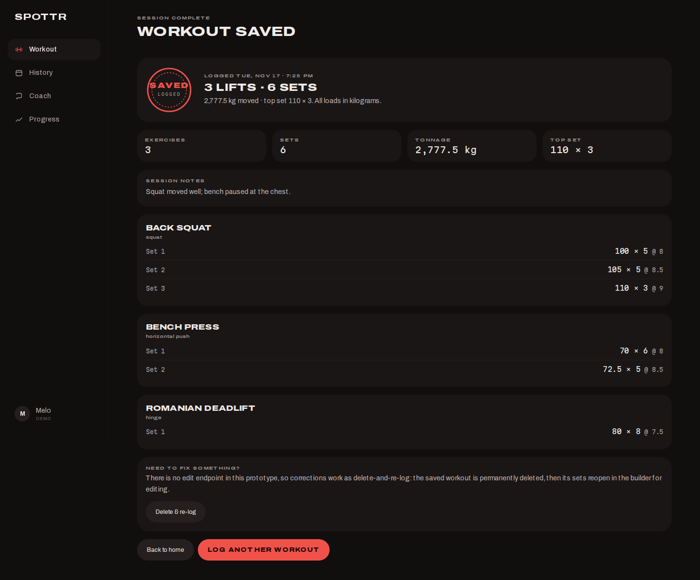

# Workout logging prototype (#10)

A runnable prototype of the wayfinder ticket
[#10 — Workout logging flow](https://github.com/aritako/spottr/issues/10), built in the
existing `web/src/features/workout-session/` slice against the real API.

- Recording: [`recording.webm`](./recording.webm) (source) · [`recording.mp4`](./recording.mp4)
  (smaller copy for review)
- Start screen: `/workouts/start`
- Saved-session screen: `/workouts/[id]`




## Run it

The API and Postgres are expected on `:8000` / `:5432` (the repo's docker compose stack).
The prototype web app must run from this worktree so the main checkout's web container is
not disturbed. It listens on `:3001`.

```bash
# API (from the repo root; the normal stack)
docker compose up -d db app
docker compose exec app alembic upgrade head
docker compose exec app python scripts/seed.py

# The seed script creates the five core lifts. This adds the accessory catalog used
# by the prototype picker so it crosses a second GET /exercises page.
node docs/prototypes/workout-logging/seed-exercises.mjs

# Web, from this worktree
pnpm install
pnpm dev:prototype
```

Open <http://localhost:3001/workouts/start>. The app talks to the API server-side through
`SPOTTR_API_URL` (default `http://localhost:8000`), so there is no CORS or browser-exposed
API origin.

## Flow

1. **Home → Start workout** opens the session builder.
2. **Add exercise** opens the catalog picker. It loads every page of
   `GET /exercises` (8 per page while looping), then filters locally as you type. This is
   the prototype's answer to the missing search/pagination on the exercise endpoint.
3. Each exercise gets editable set rows: kg, reps, optional RPE. Sets can be added,
   edited inline, and removed; mistakes are corrected before saving.
4. The sticky summary shows exercise/set counts, tonnage, the top set, and a plate loader
   for the heaviest load. Notes are optional.
5. **Finish workout** validates the session client-side and in the server action, then
   sends **one** `POST /workouts` with all nested sets.
6. **Success** redirects to `/workouts/[id]`, a server-rendered saved-session summary.
7. **Failure** leaves every client-side set intact and shows a retry panel. The prototype
   controls (a `<details>` panel in the summary) include **Simulate a failed save** so the
   failure UX can be reviewed without editing code.
8. **Delete & re-log** is the prototype correction path. It serializes the saved workout
   into `sessionStorage`, deletes it with `DELETE /workouts/{id}`, and reopens the builder
   prefilled. Saving again creates a new workout.

## Decisions recorded by this prototype

- The session is client form state until finish; one `POST /workouts` persists it. No
  set-level API calls, no background autosave, no draft endpoint.
- `performed_at` is the session start time, not the save time.
- Unit is fixed to **kg** for the prototype. A unit toggle needs conversion and is out of
  scope for #10.
- Exercises are sent by `id`; the UI never uses the API's exact, case-sensitive name
  matching.
- **Delete-and-re-log is acceptable for the MVP**, with these caveats: the confirmation
  dialog must be explicit, the sets stay in the browser, and a failed delete must leave the
  saved workout untouched. If corrections become common, a `PUT /workouts/{id}` full-replace
  endpoint is the better follow-up; there is no partial-update or set-diffing need.
- The exercise catalog has no server-side search or cursor pagination. The prototype loads
  all pages and filters locally. A production catalog should add `q` and proper pagination
  metadata, or the picker will not scale.

## Prototype limitations / follow-ups

- No draft autosave: a browser refresh during a session loses the unsaved form state.
  (The delete-and-re-log handoff survives the navigation because it uses `sessionStorage`.)
- No unit toggle, routine prefill, rest timer, PR detection, or notes templates.
- The saved-session page fetches the catalog again only to map exercise ids to names; a
  denormalized read model would avoid that.
- The saved-session page orders each exercise's sets by set id, not `set_index`, because the
  API's `set_index` is global when an explicit zero is sent. See the backend follow-up below.
- Backend follow-ups found while building this:
  - `WorkoutCreate.sets` accepts an empty list; the client guards it, but the API should
    require at least one set.
  - `WorkoutsHandler.create_workout` uses `set.set_index if set.set_index else idx`, so an
    explicit `set_index: 0` is replaced by the global order. The UI masks this by ordering on
    set id; the API should store the supplied per-exercise index.
  - Pydantic 422 responses return an array `detail`; the API client's message formatter
    only reads string details and falls back to truncated JSON.
  - There is no `PUT /workouts/{id}` and the API client originally had no
    `deleteWorkout`; this branch adds the latter (the endpoint already existed).

## Recording

The recording is generated by Playwright against the dev server on `:3001`:

```bash
pnpm exec playwright install chromium   # once
pnpm dev:prototype                      # in another shell
pnpm record:workout-logging
```

It records the full flow: home → picker → three exercises and six sets → inline
correction → simulated POST failure with state preserved → retry → saved summary →
delete-and-re-log → corrected re-save. The test verifies the deleted workout is gone
(`404`) and the corrected workout exists, then deletes the proof copy so the dev database
is left as it started.

The video is captured at 1440×900. A smaller H.264 copy is committed as
`recording.mp4`; regenerate it with any ffmpeg:

```bash
ffmpeg -i recording.webm -c:v libx264 -preset slow -crf 22 -pix_fmt yuv420p \
  -movflags +faststart -an recording.mp4
```
