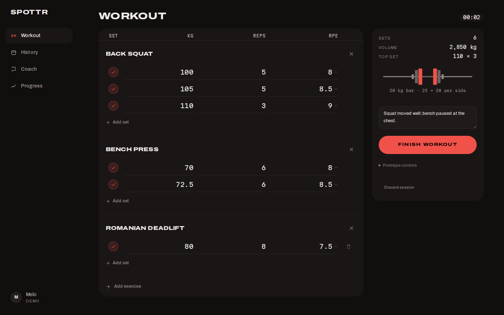
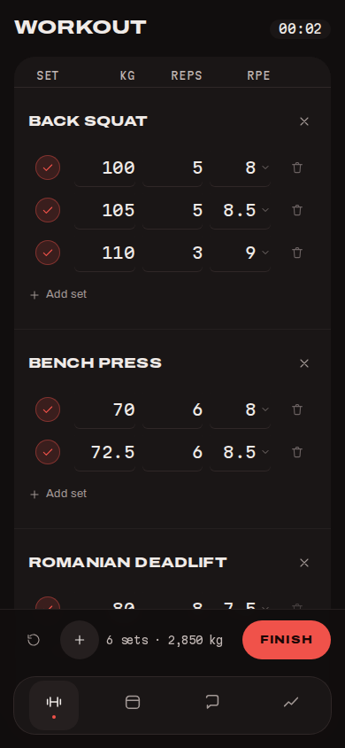
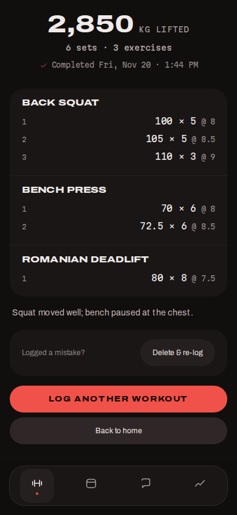

# Workout logging prototype (#10)

A runnable prototype of the wayfinder ticket
[#10 — Workout logging flow](https://github.com/aritako/spottr/issues/10), built in the
existing `web/src/features/workout-session/` slice against the real API.

- Desktop recording: [`recording.webm`](./recording.webm) (source) ·
  [`recording.mp4`](./recording.mp4) (smaller copy for review), 1440×900
- Phone recording: [`recording-mobile.webm`](./recording-mobile.webm) (source) ·
  [`recording-mobile.mp4`](./recording-mobile.mp4) (smaller copy for review), 390×844
- Start screen: `/workouts/start`
- Saved-session screen: `/workouts/[id]`




Phone layout:





## Run it

The API and Postgres are expected on `:8000` / `:5432` (the repo's docker compose stack).
The prototype web app runs from this worktree on `:3001`, so the main checkout's web
container is untouched.

```bash
# API (from the repo root; the normal stack)
docker compose up -d db app
docker compose exec app alembic upgrade head
docker compose exec app python scripts/seed.py

# Add the accessory catalog used by the picker.
node docs/prototypes/workout-logging/seed-exercises.mjs

# Web, from this worktree
pnpm install
pnpm dev:prototype
```

Open <http://localhost:3001/workouts/start>. The app talks to the API server-side through
`SPOTTR_API_URL` (default `http://localhost:8000`), so there is no CORS or browser-exposed
API origin.

## Flow

1. **Home → Start workout** opens the session builder.
2. **Add exercise** opens the catalog picker. It loads every page of `GET /exercises`
   (8 per page while looping) and filters locally as you type.
3. Each exercise gets a ruled set row: kg, reps, optional RPE. The left cell is a
   completion check; only checked sets count toward the totals and are saved. A new
   set is a plan: it copies the last load, leaves reps blank, and stays unchecked. RPE
   opens a native picker on mobile (1–10 in 0.5 steps).
4. The header shows elapsed time once the first exercise is added. The sidebar shows
   sets, volume, the top set, and a plate loader for the heaviest load. Notes are
   optional.
5. **Finish workout** validates the checked sets on the client and in the server action,
   then sends one `POST /workouts` with the completed sets.
6. **Failure** leaves every set and note intact and shows a retry panel. Retrying posts
   the same session again. The prototype controls include **Simulate a failed save** so
   the failure state can be reviewed without editing code.
7. **Success** redirects to `/workouts/[id]`, a centered receipt led by the total
   volume, then sets, exercises, and the completion date. No top set or duration.
8. **Leaving or reloading** warns while sets are unsaved. The draft is mirrored to
   `localStorage`; returning offers **Resume** or **Discard**, and the clock continues
   from the original start. On mobile, Discard lives in the action bar.
9. **Delete & re-log** is the correction path. It confirms the delete, keeps the sets in
   `sessionStorage`, deletes with `DELETE /workouts/{id}`, and reopens the builder
   prefilled. Saving again creates a new workout.

## Design notes

- The screens keep the existing **Red Lab** palette, type tokens, and primitives; the
  cleanup adds no new UI component.
- The saved screen is a centered receipt: volume, sets, exercises, and the completion
  date with a small inline check. No top set, no duration, no large stamp.
- The mobile bar holds discard, add-exercise, the live totals (or the field-error
  count), and Finish. The header carries the elapsed clock in a pill, so the page title
  stays on one line.
- Copy is sentence case and user-facing. API, endpoint, and storage details live in this
  document, not in the UI.
- Set rows are a ruled grid: units are labelled once in the sheet header, not per card.
  The header stays pinned while the sheet scrolls. Remove-set is visible on touch and
  appears on hover/focus with a pointer.
- The exercise picker is a bottom sheet below `sm` and the centered 520px modal above it.

## Decisions recorded by this prototype

- The session is client form state until finish; one `POST /workouts` persists the
  checked sets. No set-level API calls and no server draft endpoint. The active session
  is mirrored to browser `localStorage` so a reload or discarded tab can resume it; it
  is cleared on save or discard and expires after 24 hours.
- Only checked sets are validated, counted, and sent. A new set copies the last load,
  leaves reps blank, and starts unchecked; the check is the commit.
- `performed_at` is the session start time, not the save time.
- Unit is fixed to **kg**. A unit toggle needs conversion and is out of scope for #10.
- Exercises are sent by `id`; the UI never uses the API's exact, case-sensitive name
  matching.
- The builder shows wall-clock elapsed time from the first exercise. The saved receipt
  records the completion date/time, not a duration; a stored `ended_at` or
  `duration_seconds` is the production follow-up if the coach needs session length.
- RPE uses a 1–10 picker in 0.5 steps on mobile; the API still accepts any 0–10 value.
- **Delete-and-re-log is acceptable for the MVP**, with these caveats: the confirmation
  dialog must be explicit, the sets stay in the browser, and a failed delete must leave
  the saved workout untouched. If corrections become common, a `PUT /workouts/{id}`
  full-replace endpoint is the better follow-up; there is no partial-update or
  set-diffing need.
- The exercise catalog has no server-side search or cursor pagination. The prototype
  loads all pages and filters locally. A production catalog should add `q` and proper
  pagination metadata.

## Prototype limitations / follow-ups

- Draft recovery is browser-local: another device or cleared storage loses it. It is
  not a server draft, and the clock is wall-clock rather than pause-aware.
- Removing an exercise offers a six-second undo; removing a set is immediate.
- The picker's no-match state offers Clear search; creating a missing exercise from
  inside the picker is a follow-up.
- The saved receipt has no duration and no top set; the builder's top set is the
  heaviest completed set, not a programmed top set.
- No unit toggle, routine prefill, rest timer, PR detection, or notes templates.
- The saved-session page fetches the catalog again only to map exercise ids to names; a
  denormalized read model would avoid that.
- The saved-session page orders each exercise's sets by set id, not `set_index`, because
  the API's `set_index` is global when an explicit zero is sent.
- Backend follow-ups found while building this:
  - `WorkoutCreate.sets` accepts an empty list; the client guards it, but the API should
    require at least one set.
  - `WorkoutsHandler.create_workout` uses `set.set_index if set.set_index else idx`, so an
    explicit `set_index: 0` is replaced by the global order. The UI masks this by
    ordering on set id; the API should store the supplied per-exercise index.
  - Pydantic 422 responses return an array `detail`; the API client's message formatter
    only reads string details and falls back to truncated JSON.
  - There is no `PUT /workouts/{id}`; this branch adds `deleteWorkout` to the API client
    for the correction path (the endpoint already existed).

## Recording

The recordings are generated by Playwright against the dev server on `:3001`, once at
desktop size (1440×900) and once at phone size (390×844):

```bash
pnpm exec playwright install chromium   # once
pnpm dev:prototype                      # in another shell
pnpm record:workout-logging
```

`pnpm record:workout-logging` runs both spec files:
`e2e/record-workout-logging.spec.ts` (desktop) and
`e2e/record-workout-logging-phone.spec.ts` (phone). Both share the flow in
`e2e/workout-logging-recording.ts`.

The flow covers: home → picker → three exercises and six sets → inline correction →
simulated save failure with state preserved → retry → saved summary → delete-and-re-log
→ corrected re-save. The test verifies the deleted workout is gone (`404`) and the
corrected workout exists, then deletes the proof copy so the dev database is left as it
started. Captions are short sentence-case labels, placed above the mobile nav.

A smaller H.264 copy is committed for each viewport; regenerate with any ffmpeg:

```bash
ffmpeg -i recording.webm -c:v libx264 -preset slow -crf 22 -pix_fmt yuv420p \
  -movflags +faststart -an recording.mp4
ffmpeg -i recording-mobile.webm -c:v libx264 -preset slow -crf 22 -pix_fmt yuv420p \
  -movflags +faststart -an recording-mobile.mp4
```

On a minimal WSL image, Playwright's Chromium also needs the usual system libraries
(`sudo pnpm exec playwright install-deps chromium`); the recording run in this repo used
a local `libasound2` extraction because the environment had no sudo.
